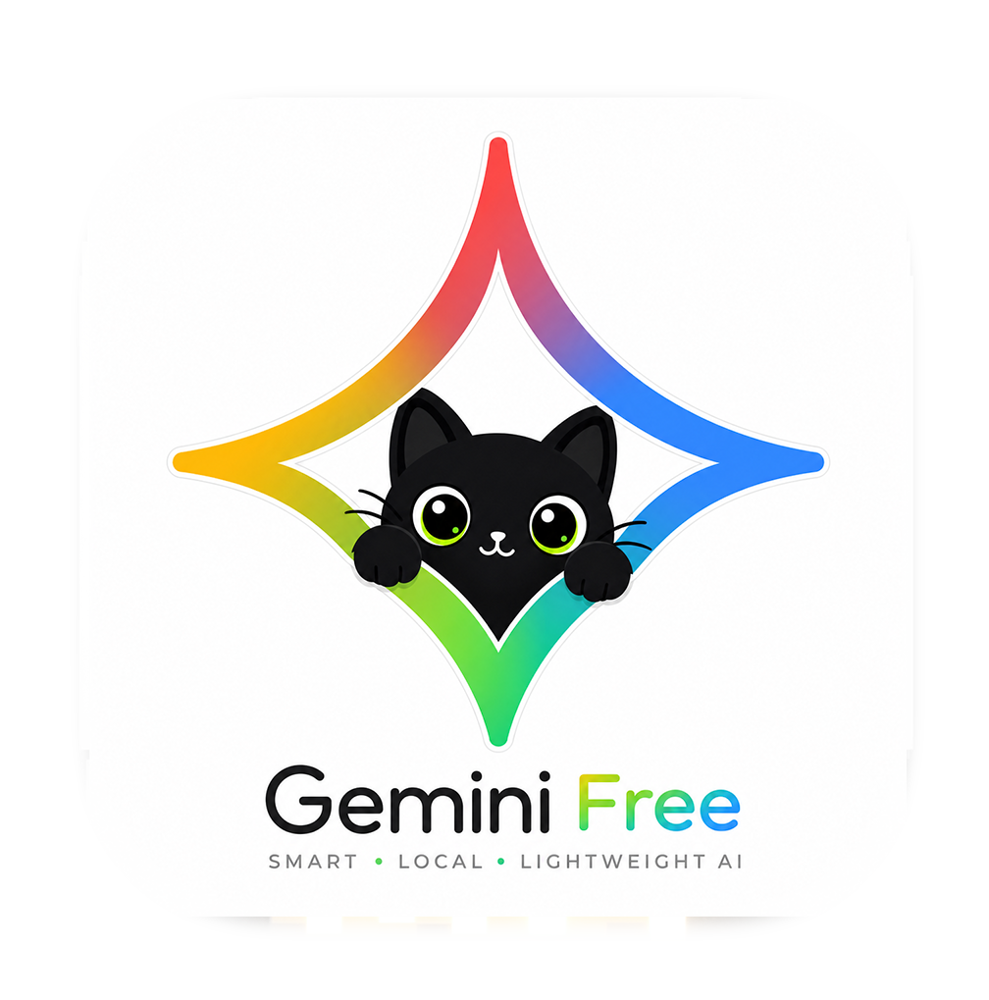
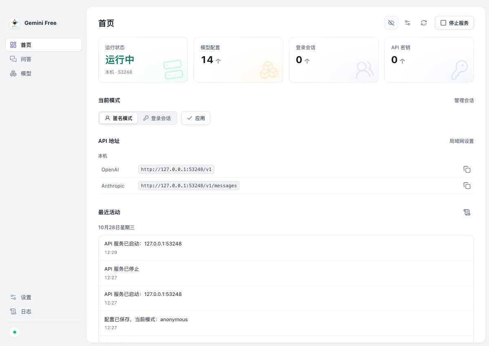
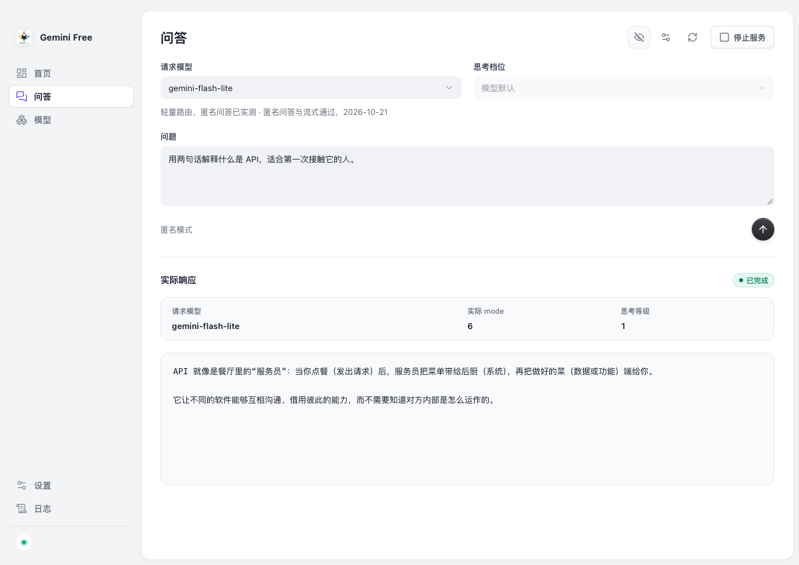
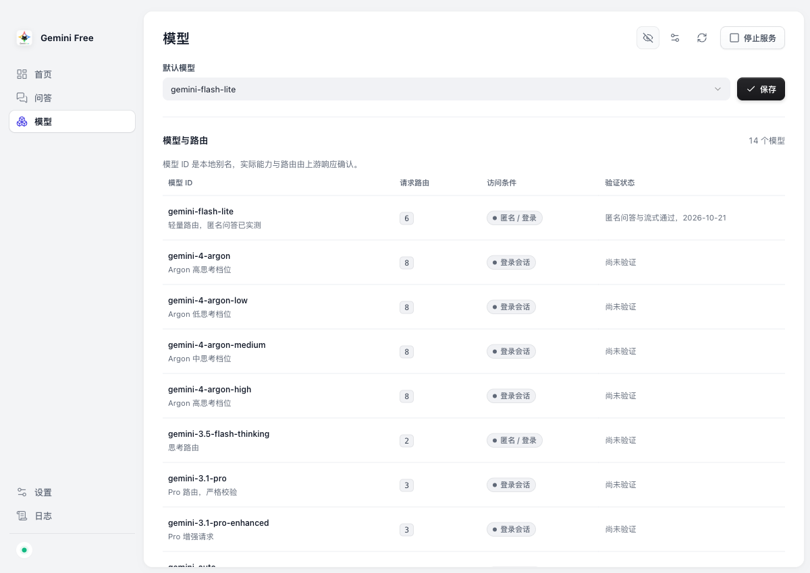

<p align="center">
  
</p>

<h1 align="center">Gemini Free</h1>

<p align="center">把 Gemini 网页端接到你常用的 AI 客户端。支持 macOS 和 Windows。</p>

<p align="center">
  <a href="https://github.com/wp-x/gemini-free/releases/latest">下载安装</a> ·
  <a href="docs/releases/v2.0.0.md">2.0 更新说明</a> ·
  <a href="#接入客户端">API 接入</a>
</p>

以前的 Gemini Free 是一个 Mac 菜单栏工具。2.0 用 Go + MyGo 重写，加入 Windows 支持，也把服务开关、问答测试、模型列表和设置放进了完整的桌面界面。

应用在本机提供 OpenAI Chat Completions 和 Anthropic Messages 兼容接口。不需要 Google AI Studio API Key；可以先用匿名模式，或者导入自己的 Gemini 登录会话。



## 下载与安装

| 系统 | 安装包 | 说明 |
| --- | --- | --- |
| macOS 12 及以上 | [Gemini Free 2.0.0.dmg](https://github.com/wp-x/gemini-free/releases/download/v2.0.0/Gemini%20Free%202.0.0.dmg) | 同时支持 Apple Silicon 和 Intel，打开后拖入 Applications |
| Windows x64 | [Gemini Free Setup 2.0.0 amd64.exe](https://github.com/wp-x/gemini-free/releases/download/v2.0.0/Gemini%20Free%20Setup%202.0.0%20amd64.exe) | 安装版，使用系统 WebView2；已在 Windows 11 验证启动 |

[发布页](https://github.com/wp-x/gemini-free/releases/latest)还提供 Windows 独立可执行文件和 SHA-256 校验值。macOS 安装包为本地签名，未做 Apple 公证；Windows 安装包没有发行者签名，首次打开可能出现系统提示。

从 1.x 升级时，请先退出旧程序，再替换应用。新版单独保存配置，旧版端口、代理等设置需要重新填写；登录会话页面可以导入旧版配置中的 Cookie。

## 先跑起来

1. 打开应用，在首页确认服务处于“运行中”；停止时点右上角“启动服务”。
2. 保持“匿名模式”，到“问答”页选择 `gemini-flash-lite`，发一条消息检查连接。
3. 回到首页复制 OpenAI 或 Anthropic 地址，填到你的客户端。默认端口是 `8081`，以界面显示为准。

连接不上 Gemini 时，在“设置 → 通用连接”里填写可用的 HTTP 代理，例如 `http://127.0.0.1:7890`。保存连接设置前先停止服务，保存后再启动。



关闭窗口后，服务仍在后台运行。Mac 不占用 Dock 图标，按 `Cmd+W` 隐藏窗口，点击菜单栏图标重新打开；Windows 从系统托盘打开。选择“退出”才会结束程序和服务。

## 匿名模式与登录会话

**匿名模式**不读取账号 Cookie。先用它确认网络和普通问答是否正常；网页端的可用范围会变化，不能据此判断高级模型权限。

**登录会话**用于请求账号可用的模型。在“设置 → 登录会话”中导入自己的 Cookie 文本或 JSON，回到首页选择该会话并点“应用”。导入成功只说明凭据已保存，是否能调用某个模型，还要在问答页验证。

会话缺少必要的网页参数时，程序会使用导入的 Cookie 获取参数。已有会话也能手动“同步参数”或“更新 Cookie”。**新版不会自动续期 Cookie**，失效后需要手动更新。

Cookie、会话参数和 API 密钥在本机加密保存，主密钥由 macOS 钥匙串或 Windows 系统凭据库保存。



模型列表中的名称是本地请求别名，不等于 Google 对实际模型版本的确认。程序会核对高级路由和 Argon 思考档位；请求高档却返回低档时会报错，不会将低档回复当作高档成功。

**已知限制：Argon 高档仍可能返回档位不匹配或超时。** 此次桌面重构没有解决上游高档稳定性问题；低档成功也不代表高档可用。具体结果以问答页显示的实际路由和档位为准。

## 接入客户端

默认地址如下；修改端口后请从首页重新复制。

| 配置项 | 默认值 |
| --- | --- |
| OpenAI Base URL | `http://127.0.0.1:8081/v1` |
| Anthropic Base URL | `http://127.0.0.1:8081` |
| Anthropic Messages 完整地址 | `http://127.0.0.1:8081/v1/messages` |
| 入门模型 | `gemini-flash-lite` |

没有设置访问密钥时，本机接口不要求鉴权；客户端强制填写 API Key 时可填占位值。设置了访问密钥后，客户端必须使用其中一个有效密钥。

下面的命令可在 macOS 终端执行；Windows 客户端填写同样的地址和模型即可。

```bash
curl http://127.0.0.1:8081/v1/chat/completions \
  -H 'Content-Type: application/json' \
  -d '{"model":"gemini-flash-lite","messages":[{"role":"user","content":"你好"}],"stream":true}'
```

支持的接口：

- `GET /health`：检查本地服务。
- `GET /v1/models`：获取模型列表。
- `POST /v1/chat/completions`：OpenAI 格式的文本问答，支持流式输出。
- `POST /v1/messages`：Anthropic 格式的文本问答，支持流式输出。
- `POST /v1/messages/count_tokens`：本地 token 估算，并非官方精确计数。

目前不提供 Responses API、Gemini 原生 API 或绘图接口，也不支持图片输入。客户端发送这些请求会明确报错。

工具调用通过结构化提示词和结果解析适配，支持工具结果续轮。它不是 Gemini 官方函数调用接口；带工具的请求需要等完整回复生成后再解析，参数无效或调用未声明工具时会报错。

## 局域网与设置

默认只监听本机。需要给同一局域网内的设备使用时，在“设置 → 通用连接”开启局域网访问，并设置访问密钥；保存并启动后，首页会列出可用地址。管理界面始终只在本机开放。

配置文件位置：

- macOS：`~/Library/Application Support/Gemini Free/config.json`
- Windows：`%AppData%\Gemini Free\config.json`

遇到问题先看“日志”，再到“问答”页重现。服务启动失败、上游超时、Cookie 失效和模型档位不匹配会分别显示错误。

## 从源码运行

使用 Go 1.27.1 和 MyGo v0.6.0。桌面界面随 Go 程序嵌入，不需要额外启动前端开发服务器。

```bash
go run ./cmd/gemini-free
```

需要独立配置或代理时：

```bash
go run ./cmd/gemini-free -config /path/to/config.json -proxy http://127.0.0.1:7890
```

`-no-start` 表示打开客户端但不启动 API，`-headless` 表示不创建窗口和托盘。

运行测试与静态检查：

```bash
go test -race -timeout 60s ./internal/... ./desktop/... ./cmd/...
go vet ./internal/... ./desktop/... ./cmd/...
```

在 macOS 上构建双端安装包，需要安装 NSIS：

```bash
brew install makensis
bash scripts/build-desktop.sh
```

产物位于 `dist/darwin-universal/` 和 `dist/windows-amd64/`。GitHub Actions 使用同一构建脚本；版本标签会生成待检查的 Release 草稿。

## 致谢

协议实现参考 [gemini-web2api](https://github.com/Sophomoresty/gemini-web2api)，桌面框架使用 [MyGo](https://github.com/egoist/mygo)。Gemini Free 是第三方项目，与 Google 无隶属关系，调用范围受网页端和账号权限限制。
